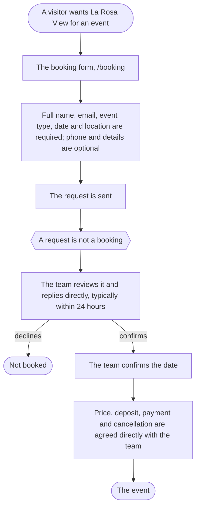
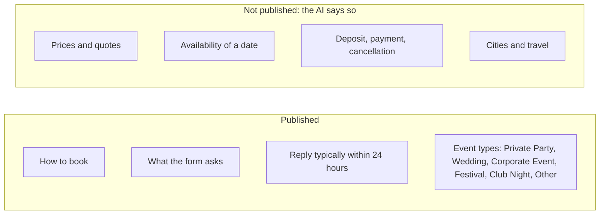

# Booking journey

## From request to event

From [[Booking La Rosa View]], [[Booking requests]] and [[La Rosa View policies]].

## What is published and what is not

The open questions behind the second box: [[Open questions for the owner]].
