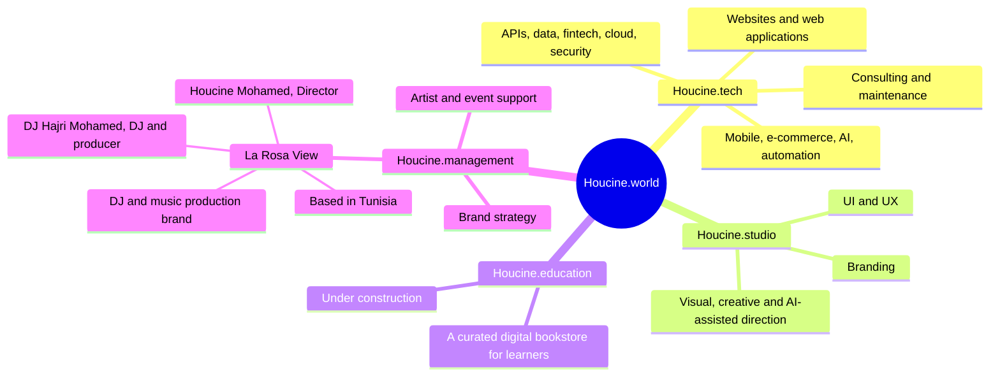
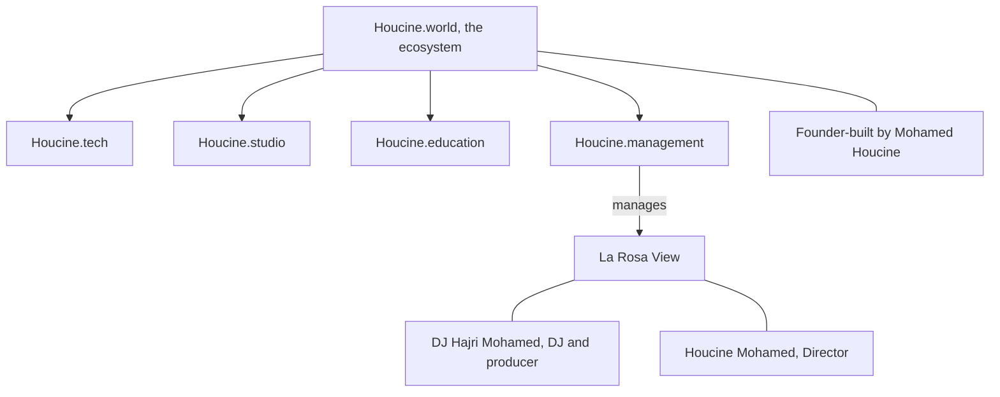
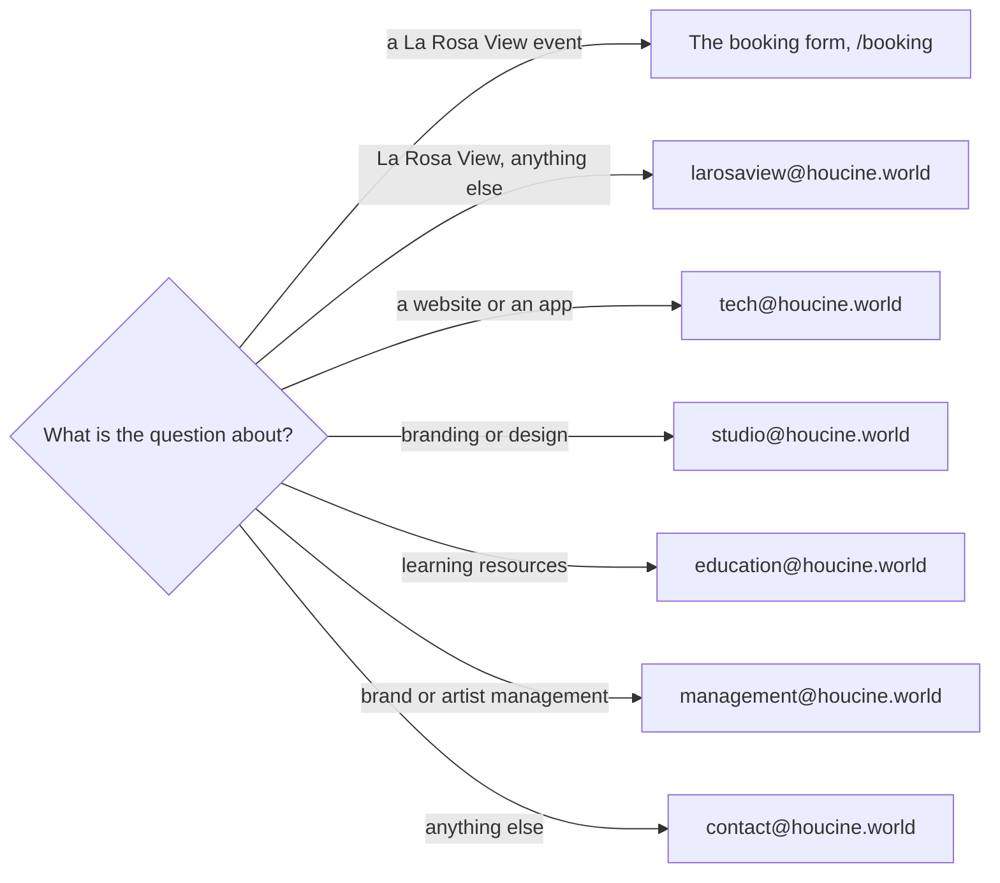

# Ecosystem diagram

## The brands

From [[Houcine.world]], [[How the Houcine.world brands connect]], [[Houcine.tech services]], [[Houcine.studio]],
[[Houcine.education]], [[Houcine.management]] and [[La Rosa View]].

## Who manages whom

## Who to write to

From [[Contacting Houcine.world]] and [[Contacting La Rosa View]].
