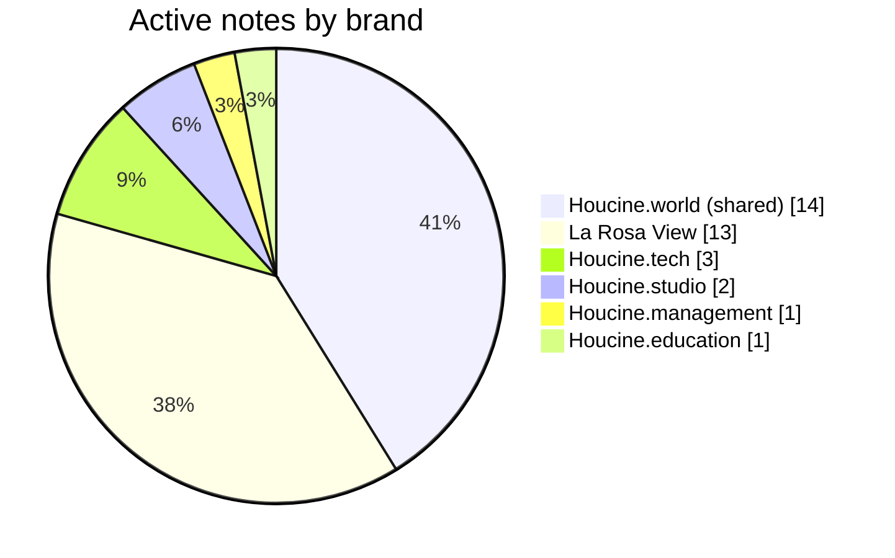
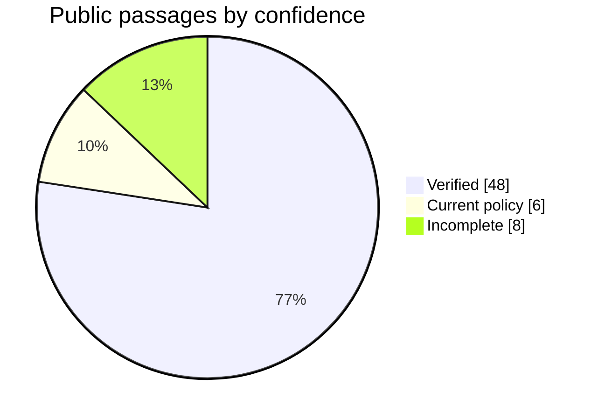
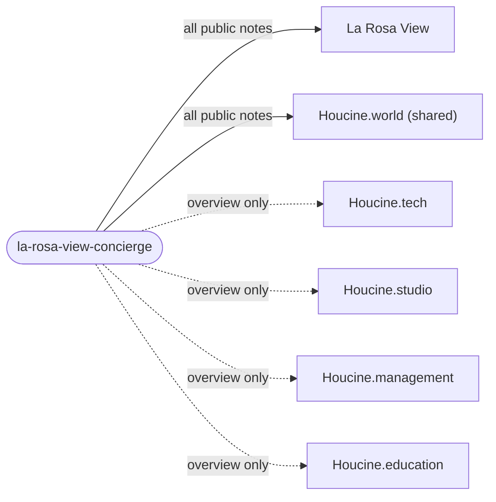
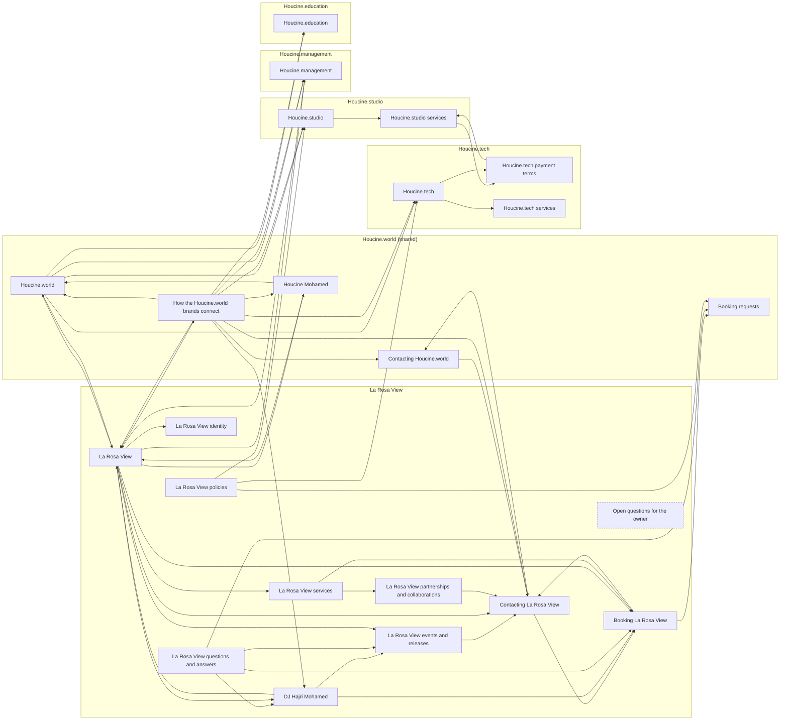

# Brain dashboard

> [!info] Generated from the notes by `scripts/brain/build.mjs` and by every Knowledge Studio publication. Do not edit:
> it is rewritten each time. Charts are Mermaid diagrams, which Obsidian and GitHub draw without any plugin.
> AI index fingerprint `dde65f925c572593`.

## At a glance

| | |
| --- | --- |
| Active notes | 34 (24 public, 10 internal, 0 restricted) |
| Archived notes | 0 |
| Passages the public AI can read | 62 |
| Links between notes | 52 |
| Sections waiting for the owner | 8 |

## Notes by brand

## How sure the public knowledge is

Every passage the public AI can read, by its confidence. The AI never states an incomplete, unconfirmed or outdated passage as a fact.

## Passages per brand in the AI's index

| Brand | Passages | |
| --- | ---: | --- |
| Houcine.world (shared) | 11 | █████ |
| La Rosa View | 43 | ████████████████████ |
| Houcine.tech | 4 | ██ |
| Houcine.studio | 2 | █ |
| Houcine.management | 1 | ▏ |
| Houcine.education | 1 | ▏ |

## Visitor questions answered

The fixed visitor questions of `supabase/functions/_shared/brain/coverage-questions.ts`, searched without any AI call (Knowledge Studio, AI Playground, Coverage).

| Brand | Answered | Awaiting confirmation | Known gaps | Not found | Answered share |
| --- | ---: | ---: | ---: | ---: | --- |
| Houcine.world (shared) | 6 | 0 | 3 | 0 | ███████░░░ 6/9 |
| La Rosa View | 9 | 4 | 2 | 1 | ██████░░░░ 9/16 |
| Houcine.tech | 6 | 0 | 3 | 0 | ███████░░░ 6/9 |
| Houcine.studio | 3 | 0 | 3 | 0 | █████░░░░░ 3/6 |
| Houcine.management | 2 | 1 | 3 | 0 | ███░░░░░░░ 2/6 |
| Houcine.education | 1 | 1 | 2 | 0 | ███░░░░░░░ 1/4 |

## What each public AI may read

Internal and restricted notes, drafts and archived notes never reach any AI, whatever this shows.

## Every note and its links

One box per note, grouped by brand; dashed boxes are internal (never sent to an AI). The same graph is in [[knowledge-map.canvas|the Canvas board]] and in Obsidian's graph view.

## Waiting for the owner

Public sections the AI must not state as facts until the owner confirms them (the questions to ask: [[Open questions for the owner]]).

| Note | Section | Status |
| --- | --- | --- |
| [[Houcine.education]] | What it is | Incomplete |
| [[Booking La Rosa View]] | Availability | Incomplete |
| [[Booking La Rosa View]] | Prices and quotes | Incomplete |
| [[Booking La Rosa View]] | Deposits, payment, cancellation | Incomplete |
| [[Contacting La Rosa View]] | Phone | Incomplete |
| [[La Rosa View events and releases]] | Upcoming events | Incomplete |
| [[La Rosa View policies]] | Payment, deposits, cancellation | Incomplete |
| [[La Rosa View services]] | Prices | Incomplete |
