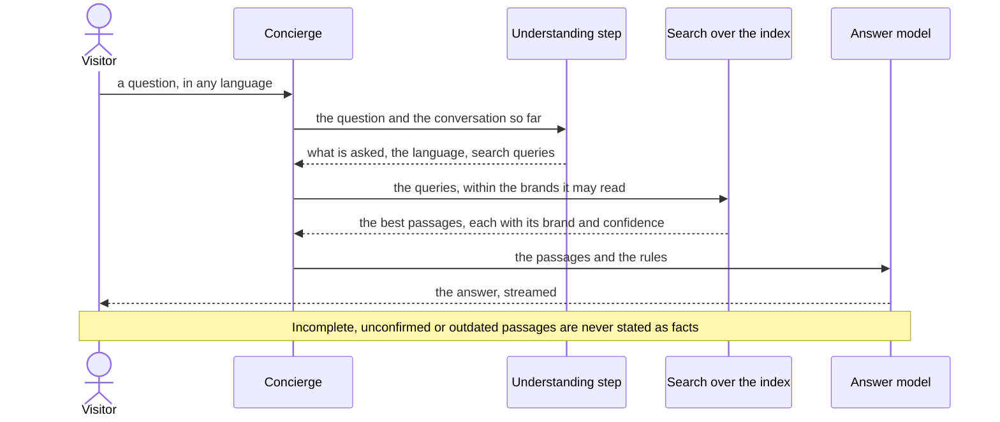
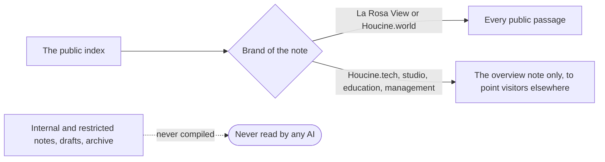

# How the AI answers

The La Rosa View Concierge, the chat on `/larosaview` (docs/knowledge-brain.md).

## One question, step by step

## What the search may read

The access is set in Knowledge Studio, Settings, AI access; the dashboard (`maps/generated/dashboard.md`) draws it from
the notes. See also [[Knowledge architecture]].
