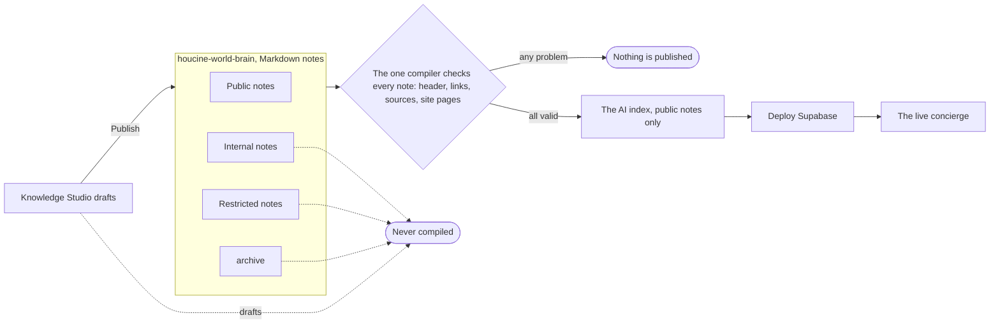
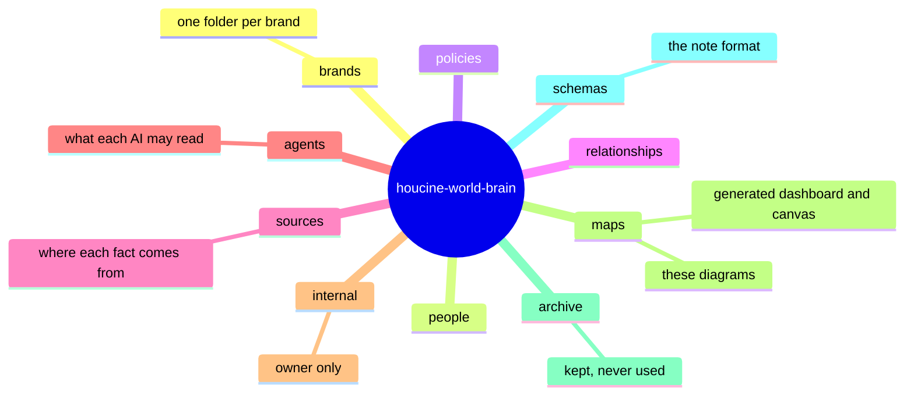

# Knowledge architecture

## From a note to the AI

## Folders

The format of a note: `schemas/note-format.md`. The guide: docs/knowledge-brain.md. See also [[How the AI answers]] and
[[Publishing flow]].
