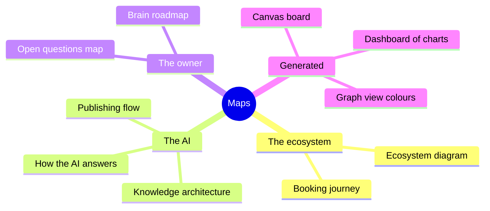

# Maps of the brain

Diagrams and charts of the knowledge, for the owner and the maintainers. They are internal: no AI ever reads this
folder. The drawings are Mermaid diagrams, which Obsidian and GitHub draw without any plugin.

## Drawn by hand (from the notes)
- [[Ecosystem diagram]]: the brands, what each does, who is behind them, and who to write to.
- [[Booking journey]]: what happens from a visitor's booking request to a confirmed event.
- [[How the AI answers]]: the path of a visitor's question through the La Rosa View Concierge.
- [[Knowledge architecture]]: from a Markdown note to the AI's index, and what never reaches it.
- [[Publishing flow]]: what "Publish" does in Knowledge Studio, and what happens when a step fails.
- [[Open questions map]]: what only the owner can answer.
- [[Brain roadmap]]: what is done, in review, waiting, and later.

## Generated from the notes (rewritten at every build and publication)
- `maps/generated/dashboard.md`: charts of the notes, confidence, visitor questions answered, every link, and the
  sections waiting for the owner.
- `maps/generated/knowledge-map.canvas`: a Canvas board of every note grouped by brand, with its links (open it in
  Obsidian).
- Obsidian's own graph view (Ctrl/Cmd+G) colours the notes by brand (`.obsidian/graph.json`).
