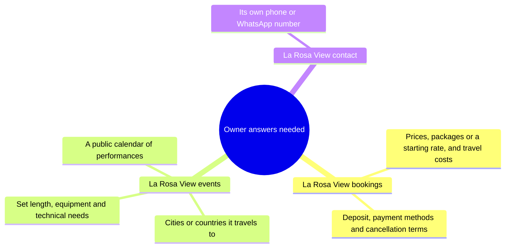
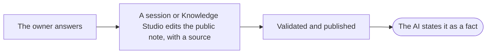

# Open questions map

What only the owner can answer, from [[Open questions for the owner]]. Until an answer is confirmed, the AI says the
detail is not published.

## How an answer reaches the AI

