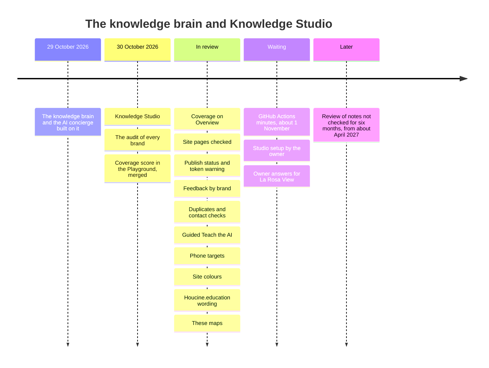

# Brain roadmap

As of 30 October 2026. Pull request numbers are in the houcine-world repository; the plan is issue #76 (epic #74).
No date is promised for anything not done.

## Timeline

## Status board

```mermaid
flowchart LR
  subgraph Done
    D1["Knowledge brain"]
    D2["Concierge on the brain"]
    D3["Knowledge Studio"]
    D4["Coverage score"]
  end
  subgraph Review["In review, waiting for the owner's merge"]
    R1["Overview coverage"]
    R2["Site pages check"]
    R3["Publish status and token warning"]
    R4["Feedback by brand"]
    R5["Duplicates and contact checks"]
    R6["Guided Teach the AI"]
    R7["Phone targets"]
    R8["Site colours"]
    R9["Houcine.education wording"]
  end
  subgraph Waiting
    W1["Actions minutes, then Deploy Supabase"]
    W2["Token and key set up by the owner"]
    W3["Owner answers"]
  end
  Done --> Review --> Waiting
```

See also [[Publishing flow]] and [[Open questions map]].
